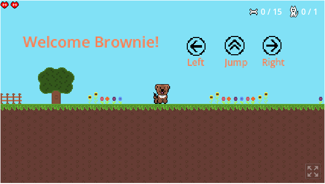

# 🐶 Jumpy Puppy

A 2D pixel-art platformer made with **Godot 4.5**. Guide Brownie the puppy through the level, follow the meows to rescue lost kittens, collect bones and stomp on rats.

> **Status: work in progress.** Level 1 (grass) is playable from start to finish. Level 2 (sky) is in progress.
>
> 🎮 **[Play it in your browser on itch.io](https://tombitminded.itch.io/jumpy-puppy)**



## Gameplay

- **Rescue the kittens.** Each level ends when every kitten is found. Kittens meow when you are in range, and the meow gets louder the closer you get (volume is mapped to distance), so you find them by ear.
- **Collect bones.** Every 5 bones restores a heart, or adds an extra heart if you are already at full health.
- **Watch out for rats.** Touching a rat costs a heart, followed by a short invincibility window (the sprite flickers). Jump on a rat to stomp it and bounce off.
- **Checkpoints.** When you lose all your hearts, Brownie respawns at the last checkpoint reached.
- **Desktop or mobile.** The main menu lets you choose keyboard controls or on-screen touch buttons.

## Controls

| Action | Keys |
|---|---|
| Move | ← → or A D |
| Jump | ↑ or W |
| Pause | P |

## How it's built

The game uses **composition**: the player is assembled from small, reusable component nodes instead of one large script.

| Component | Role |
|---|---|
| `InputComponent` | Reads keyboard and touch input; also accepts callbacks so an AI could drive the same component |
| `MovementComponent` | Running, jumping and gravity, with values tuned through a resource |
| `StateComponent` | Current state (idle, run, jump, dying…) and facing direction |
| `AnimationComponent` | Picks the animation and sound for each state |
| `HealthComponent` | Hearts, healing, death signal, linked to the heart HUD |
| `InvincibilityComponent` | Temporary invulnerability with sprite flicker after a hit |
| `DamageArea` / `Stomparea` | Enemy contact damage and stomp-from-above logic |

Other choices:
- **Resources for tuning:** movement, input and state settings live in `.tres` resources, so behaviour can be adjusted in the editor without touching code.
- **Signals** connect pickups (bones, kittens) to the counters and HUD, so collectibles don't need to know about the UI.
- **Autoload** `GameSettings` keeps the desktop/mobile choice across scenes.

```
entities/      player (Brownie), enemies (rat, bat), NPCs (kittens)
library/       reusable components and their resources
collectibles/  bones, power-ups, counters
game/levels/   level 1 (grass), level 2 (sky)
hud/           main menu
systems/       audio, game settings, mobile input buttons
```

Sprite source files (`.ase`) are included next to the exported PNGs.

## Run it

The quickest way is the [browser version on itch.io](https://tombitminded.itch.io/jumpy-puppy). To run it from source:

1. Install [Godot 4.5](https://godotengine.org/) (the project uses the GL Compatibility renderer).
2. Open `project.godot` in Godot.
3. Press **F5**.

A Web export preset is included.

## Next steps

- Finish level 2 (sky).
- Merge the two level scripts into one shared base level, and the two enemy controllers into one.
- Remove the unused `stomp_attack` component.

## AI use

- **Code:** the game code (GDScript, scenes, components) is written by hand. AI assistants were used as a learning aid, to explain Godot concepts and debug ideas, not to generate the game code.
- **Documentation:** this README was drafted with Claude (Anthropic) from the project's code, then reviewed and corrected by me. Every feature described was checked against the scripts.
